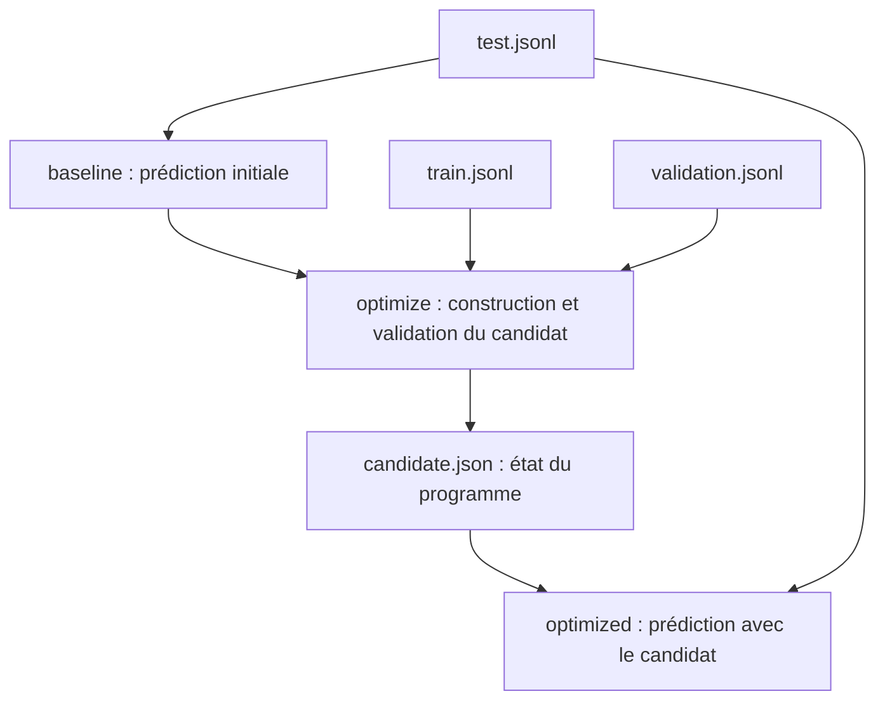

# Flow DSPy local : prédire, optimiser et réutiliser

Ce flow Kestra classe des messages clients avec DSPy et Ollama, sans clé API
ni fournisseur payant. Il compare les prédictions d'un programme initial avec
celles d'un programme auquel DSPy a ajouté des exemples d'entraînement.

## Fichiers

Tous les fichiers sont dans `examples/ollama-classification/` :

| Fichier | Utilisation |
|---|---|
| `flow.yaml` | Définition du flow à importer dans Kestra. |
| `train.jsonl` | Six messages corrigés pour construire les démonstrations. |
| `validation.jsonl` | Trois autres messages corrigés pour évaluer le candidat. |
| `test.jsonl` | Trois messages utilisés pour les prédictions avant et après optimisation. |

Chaque ligne JSONL représente un exemple :

```json
{"schemaVersion":1,"id":"train-1","inputs":{"text":"I was charged twice for my subscription."},"reference":{"category":"billing"}}
```

- `schemaVersion` : version du format attendu par le plugin.
- `id` : identifiant unique de l'exemple.
- `inputs` : valeurs transmises au programme DSPy.
- `reference` : réponse attendue, utilisée pour l'entraînement ou l'évaluation.

Les trois fichiers utilisent des identifiants distincts. Les références du
fichier de test servent à une comparaison manuelle : `Predict` ne les utilise
pas pour produire les réponses.

## Enchaînement



Kestra exécute les trois tâches dans l'ordre. Si une tâche échoue, les suivantes
ne sont pas exécutées.

### 1. `baseline` : prédire avant optimisation

La tâche `io.kestra.plugin.dspy.Predict` utilise :

- La signature `text -> category`.
- Des instructions définissant les catégories `billing`, `technical` et `other`.
- Le modèle local `ollama_chat/llama3.2:1b`.
- Le fichier `test.jsonl`.

Elle produit des prédictions initiales, sans les démonstrations apprises depuis
`train.jsonl`. Les instructions contiennent néanmoins déjà quelques exemples
rédigés manuellement.

### 2. `optimize` : construire et évaluer un candidat

La tâche `io.kestra.plugin.dspy.Optimize` utilise l'algorithme
`BOOTSTRAP_FEW_SHOT`.

DSPy utilise les données d'entraînement et un programme enseignant pour tenter
de construire des démonstrations correctes. Dans cet exemple :

- L'étudiant et l'enseignant utilisent le même modèle local pour limiter les
  téléchargements et les ressources nécessaires.
- `maxBootstrappedDemos: 1` limite les démonstrations générées et acceptées.
- `maxLabeledDemos: 6` limite les exemples corrigés pouvant être ajoutés.
- `metricThreshold: 1.0` exige une réponse correcte pour accepter une
  démonstration générée.

Le candidat est ensuite évalué sur `validation.jsonl`, qui ne sert pas à
construire ses démonstrations. La métrique par défaut compare les catégories
prédites aux références, en normalisant notamment la casse et les espaces.

Le fichier `manifest.json` contient le score de validation. Par exemple,
`validation.score: 0.666...` signifie deux bonnes réponses sur trois.

**Le seuil `metricThreshold` n'est pas une barrière de validation finale.**
Ce flow continue même si le score de validation est faible.

L'optimisation produit :

- `candidate.json` : signature, instructions, état DSPy et démonstrations du candidat.
- `manifest.json` : modèles, versions, paramètres, empreintes des données,
  score de validation et compteurs d'appels.

**Il ne s'agit pas de fine-tuning : les poids du modèle Ollama ne sont pas
modifiés.** DSPy optimise ici les démonstrations fournies au modèle.

### 3. `optimized` : réutiliser le candidat

La dernière tâche `Predict` charge :

```yaml
artifactUri: "{{ outputs.optimize.candidateArtifactUri }}"
```

Elle récupère ainsi la définition du programme et le modèle étudiant enregistrés
dans l'artefact, puis traite le même `test.jsonl` que `baseline`.

Elle ne relance pas l'optimisation. Cela permet de comparer les réponses avant
et après ajout des démonstrations.

## Exécution dans Kestra

Prérequis :

- Kestra avec le JAR du plugin DSPy chargé et l'accès au socket Docker.
- L'image Docker `plugin-dspy:3.4.1` disponible sur le Docker du worker.
- Ollama démarré sur le Mac avec le modèle `llama3.2:1b` téléchargé.

Le flow cible Docker Desktop sur Mac : les conteneurs joignent Ollama avec
`http://host.docker.internal:11434`. Pour une autre infrastructure, adapter
`DSPY_STUDENT_API_BASE` et `DSPY_TEACHER_API_BASE`.

Pour lancer le flow :

1. Créer un flow dans Kestra et y copier le contenu de `flow.yaml`.
2. Enregistrer, puis cliquer sur **Execute**.
3. Joindre `train.jsonl` au champ `train`.
4. Joindre `validation.jsonl` au champ `validation`.
5. Joindre `test.jsonl` au champ `test`, puis lancer.

## Résultats

Dans l'onglet **Outputs**, les sorties du flow exposent les URI suivantes :

| Sortie | Contenu |
|---|---|
| `baseline_predictions` | Prédictions avant optimisation. |
| `optimized_predictions` | Prédictions après optimisation. |
| `validation_report` | Rapport du candidat, dont `validation.score`. |
| `reusable_artifact` | Programme optimisé pouvant être réutilisé dans un autre flow. |

Les fichiers sont conservés dans le stockage interne de Kestra, pas
automatiquement dans le dossier du projet. Les sorties des tâches sont également
accessibles : `baseline.predictionsUri`, `optimized.predictionsUri`,
`optimize.manifestUri` et `optimize.candidateArtifactUri`.

Chaque prédiction contient le texte d'entrée et la catégorie produite :

```json
{"schemaVersion":1,"id":"test-1","inputs":{"text":"Please send me my invoice."},"outputs":{"category":"billing"},"artifactVersion":"..."}
```

Pour ce jeu de test, les catégories attendues sont :

| Identifiant | Catégorie attendue |
|---|---|
| `test-1` | `billing` |
| `test-2` | `technical` |
| `test-3` | `other` |

Le flow ne calcule pas automatiquement de score avant/après sur le test :
comparer les deux fichiers de prédictions avec ces références. Le score dans
`validation_report` porte uniquement sur le jeu de validation du candidat.

## Limites

- `llama3.2:1b` est un petit modèle : il peut mal classer un texte ou ne pas
  respecter le format DSPy, ce qui peut faire échouer une tâche.
- L'optimisation ne garantit pas une amélioration, surtout avec le même petit
  modèle pour l'enseignant et l'étudiant.
- Ces quelques exemples servent à une démonstration technique, pas à une mesure
  fiable de qualité en production.
- Les budgets `maxLlmCalls` s'appliquent séparément à chaque tâche. Les délais
  limitent les requêtes individuelles et la durée globale des tâches.
- L'artefact peut contenir des exemples d'entraînement : le traiter comme les
  données sources s'ils sont confidentiels.
