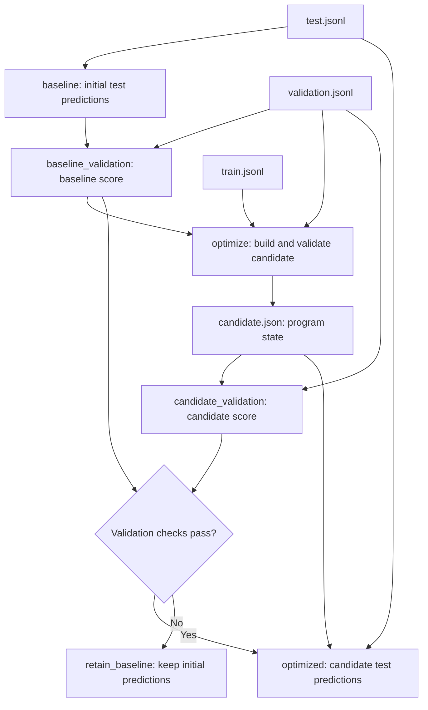

# Local DSPy flow: predict, optimize and reuse

You can test the DSPy plugin with this example using Kestra and local Ollama
models, without an API key or a paid provider. The flow classifies customer
messages, evaluates a baseline and an optimized candidate, and selects the
candidate only when it passes the validation checks.

## Files

All files are in `examples/ollama-classification/`:

| File | Purpose |
|---|---|
| `flow.yaml` | Flow definition to import into Kestra. |
| `train.jsonl` | Six labeled messages used to build demonstrations. |
| `validation.jsonl` | Three separate labeled messages used to evaluate the baseline and candidate. |
| `test.jsonl` | Three messages used to evaluate predictions before optimization and, if accepted, after optimization. |

Each JSONL line represents an example:

```json
{"schemaVersion":1,"id":"train-1","inputs":{"text":"I was charged twice for my subscription."},"reference":{"category":"billing"}}
```

- `schemaVersion`: format version expected by the plugin.
- `id`: unique example identifier.
- `inputs`: values passed to the DSPy program.
- `reference`: expected output, used for training or evaluation.

The three files use disjoint IDs. With `evaluate: true`, `Predict` uses test
references to score predictions, not to generate answers. Test scores never
determine whether the candidate is accepted.

## Flow sequence



Kestra runs the top-level tasks in order, then executes the selected branch.
If a task fails, subsequent tasks are not executed; the baseline fallback applies
to a rejected validation score, not to execution failures.

### 1. `baseline` and `baseline_validation`: evaluate the initial program

Both `io.kestra.plugin.dspy.Predict` tasks use:

- The `text -> category` signature.
- Instructions defining the `billing`, `technical` and `other` categories.
- The local `ollama_chat/llama3.2:1b` model.
- `responseFormat: JSON` to request JSON output.
- `evaluate: true` to score predictions against references.

`baseline` processes `test.jsonl`; `baseline_validation` processes
`validation.jsonl`. Neither uses demonstrations learned from `train.jsonl`,
although the shared instructions already contain a few manually written examples.

### 2. `optimize`: build and evaluate a candidate

The `io.kestra.plugin.dspy.Optimize` task uses `BOOTSTRAP_FEW_SHOT`.

DSPy uses training data and a teacher program to build correct demonstrations.
In this example:

- The student uses `ollama_chat/llama3.2:1b`.
- The teacher uses the larger `ollama_chat/llama3.2:3b` model.
- `maxBootstrappedDemos: 1` limits accepted generated demonstrations.
- `maxLabeledDemos: 6` limits labeled examples that can be added.
- `metricThreshold: 1.0` requires a correct answer to accept a generated
  demonstration.

The candidate is then evaluated on `validation.jsonl`, which is not used to
build its demonstrations. The default metric compares predicted categories with
references, normalizing case and whitespace among other transformations.

The manifest contains this validation score. For example,
`validation.score: 0.666...` means two correct answers out of three.

**`metricThreshold` is not the final candidate acceptance threshold.**
Candidate selection happens later in `select_candidate`.

Optimization produces:

- `candidate.json`: program definition, response format, student model, DSPy
  state and candidate demonstrations.
- A manifest: models, versions, parameters, dataset hashes, validation score
  and model-call counts.

**This is not fine-tuning: Ollama model weights are not modified.**
DSPy optimizes the demonstrations supplied to the model.

### 3. `candidate_validation` and `select_candidate`: select the program

`candidate_validation` reloads the candidate artifact and evaluates it again on
`validation.jsonl`. `select_candidate` accepts it only if this score:

- Meets `minimum_validation_score`, which defaults to `0.8`.
- Is at least as high as `baseline_validation.evaluationScore`.

With only three validation examples, the default threshold requires three
correct answers. The manifest score comes from the evaluation during optimization;
selection uses the separate `candidate_validation` score. These scores may differ
because model responses are not guaranteed to be deterministic.

### 4. `optimized` or `retain_baseline`: use the selected program

If accepted, the `optimized` task loads:

```yaml
artifactUri: "{{ outputs.optimize.candidateArtifactUri }}"
```

It restores the program definition, response format and student model saved in
the artifact, then predicts and evaluates on the same `test.jsonl` as `baseline`,
without running optimization again.

If rejected, `retain_baseline` logs the decision and the flow returns the initial
baseline predictions instead.

## Run in Kestra

Prerequisites:

- Kestra with the DSPy plugin JAR loaded and access to Docker for the TaskRunner.
- The `plugin-dspy:3.4.1` image available on the worker's Docker daemon.
- Ollama running on your Mac with both `llama3.2:1b` and `llama3.2:3b` downloaded.

Download the models:

```bash
ollama pull llama3.2:1b
ollama pull llama3.2:3b
```

The flow targets Docker Desktop on Mac: containers reach Ollama through
`http://host.docker.internal:11434`. Ollama must listen on an address reachable
from Docker. If needed, stop the existing Ollama server and start it with:

```bash
OLLAMA_HOST=0.0.0.0:11434 ollama serve
```

This also exposes Ollama to the local network; use it only on a trusted network
with appropriate access restrictions. For other infrastructure, adapt
`DSPY_STUDENT_API_BASE` and `DSPY_TEACHER_API_BASE`.

To run the flow:

1. Create a flow in Kestra and paste the contents of `flow.yaml`.
2. Save it, then click **Execute**.
3. Attach `train.jsonl`, `validation.jsonl` and `test.jsonl` to their corresponding inputs.
4. Set `minimum_validation_score` if needed, then start the execution.

## Results

The flow exposes these values in the **Outputs** tab:

| Output | Content |
|---|---|
| `baseline_predictions` | URI of predictions before optimization. |
| `selected_predictions` | URI of candidate predictions if accepted, otherwise baseline predictions. |
| `validation_report` | URI of the optimization manifest, including `validation.score`. |
| `candidate_artifact` | URI of the candidate program, available even if rejected. |
| `candidate_accepted` | Whether the candidate passed the selection checks. |
| `baseline_validation_score` | Baseline score on the validation dataset. |
| `candidate_validation_score` | Candidate score used for selection. |

Files are kept in Kestra's internal storage, not automatically in the project
directory. Task outputs also expose `baseline.predictionsUri`,
`optimize.manifestUri` and `optimize.candidateArtifactUri`.
`optimized.predictionsUri` is available only when the candidate is accepted.

Each prediction contains the input text and the generated category:

```json
{"schemaVersion":1,"id":"test-1","inputs":{"text":"Please send me my invoice."},"outputs":{"category":"billing"},"artifactVersion":"..."}
```

The expected test categories are:

| ID | Expected category |
|---|---|
| `test-1` | `billing` |
| `test-2` | `technical` |
| `test-3` | `other` |

Test evaluation scores are available as `outputs.baseline.evaluationScore` and,
if accepted, `outputs.optimized.evaluationScore`. They are reported for comparison
only and do not affect candidate selection.

## Limitations

- `llama3.2:1b` is a small model: it may misclassify text or return invalid output,
  causing a task to fail. JSON response format does not guarantee valid answers.
- Optimization does not guarantee improvement, even with a larger teacher.
- These few examples demonstrate the integration, not reliable production quality.
- `maxLlmCalls` budgets apply separately to each task attempt. Request and task
  timeouts bound individual calls and overall task duration.
- The artifact may contain training examples; treat it like the source datasets
  if they are confidential.
